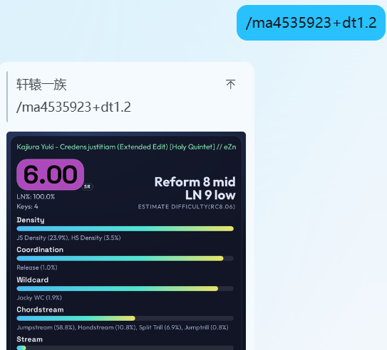

# astrbot_plugin_osu_mania_map_analyser

AstrBot 插件版 `osumania_map_analyser`。机器人可通过 `/ma <bid>` 下载 `.osu`、用 Playwright 驱动常驻 Chromium 渲染图表，并返回 PNG 图片。



原始项目地址：<https://github.com/LeoBlackMT/osumania_map_analyser>

> 项目内 `osumania_map_analyser/ManiaMapAnalyser by Leo_Black` 已同步到上游 `fddbad2`（v1.5.0）运行时代码；受 AstrBot 插件安装行为限制，仍未采用 submodule。

## 安装

首次使用前，除了安装 Python 依赖，还需要额外安装 Playwright 的 Chromium 内核。建议在 AstrBot 实际运行插件的同一 Python 环境中执行：

```powershell
python -m playwright install-deps chromium
```

验证，预期输出：`Chromium OK: ...`
```powershell
python - <<'PY'
import asyncio
from playwright.async_api import async_playwright

async def main():
    p = await async_playwright().start()
    browser = await p.chromium.launch(headless=True, args=["--no-sandbox"])
    print("Chromium OK:", browser.version)
    await browser.close()
    await p.stop()

asyncio.run(main())
PY
```

## 使用

基于 `osumania_map_analyser` 实现本项目，可以分析键型、SV，并预估对应 RF/LN 段位。当前默认开启 SV 检测；若误判较多，可在插件配置中将 `debug_use_sv_detection` 关闭。

```text
/ma <bid>       默认等同于 /ma -a <bid>
/ma -n <bid>    主体不显示任何内容，即短卡片模式
/ma -a <bid>    主体内容按谱面 LN 占比自动选择 Pattern 或 Etterna
/ma -p <bid>    主体显示 Pattern 键型分析，非 4/6/7K 主体自动回退 Pattern
/ma -e <bid>    主体显示 Etterna 7 大键型分
/ma -g <bid>    主体显示难度变化图，命令简写 /mag
/ma help        显示本帮助文本

示例:
/ma 5170433+dt1.1
```

## 引用 Yumu 成绩图分析

在 QQ / NapCat 中回复一张完整 Yumu 成绩图，发送 `/ma` 即可识别中间下方卡片右下角的 bid 并分析：

```text
/ma            默认分析
/mag           难度变化图
/ma -e         Etterna 分析
/ma +dt1.1     以 1.1 倍速分析
/ma -e+ht      Etterna 分析，0.75 倍速
```

显式输入 `/ma <bid>` 时不会读取图片；`/ma help` 始终显示帮助。截图中的 mod 不会自动继承。无引用图片时显示帮助，多图引用时提示只引用一张。首版支持固定布局的完整 16:9 Yumu 成绩卡（JPEG/PNG/WEBP），不支持手机聊天截图、边框或裁切；宽度至少 640 像素，文件不超过 15 MiB、总像素不超过 1600 万。

插件分别识别原色裁剪图和增强灰度图，只在两次数字一致且均达到置信度阈值时分析；否则提示手动输入 `/ma <bid>`。识别结果仅接受 `b` 前缀或纯数字形式的 5–10 位正整数，不猜测 O/0、I/1 等相似字符，也不补全被裁掉的数字。两次一致不能保证绝无误识别；如分析了错误谱面，直接使用显式 bid 重试。

安装 `requirements.txt` 即可使用 OCR，无需 Tesseract、GPU 或 PyTorch。使用 `rapidocr-onnxruntime==1.4.4` 自带的 PP-OCRv4 文字识别模型（约 10.4 MiB），仅懒加载这个模型，检测和方向分类模型不加载。模型位于 Python 环境的 `rapidocr_onnxruntime/models/`，随 pip 包安装，首次识别无需再次联网下载。上游包依赖 OpenCV；无图形环境的 Linux 如缺少 `libGL`，可以使用下面的 headless 安装方式（建议在 AstrBot 独立虚拟环境中执行）：

```text
python -m pip install --no-deps rapidocr-onnxruntime==1.4.4
python -m pip install "Pillow>=10,<13" "numpy>=1.24,<2" "onnxruntime>=1.17,<2" "opencv-python-headless>=4.8,<4.12" pyclipper six Shapely PyYAML tqdm
```

不要同时安装 `opencv-python` 与 `opencv-python-headless`，两者共用 `cv2` 命名空间；已安装普通版时先卸载，再安装 headless 版。常规 `requirements.txt` 安装遵循 RapidOCR 上游的普通版依赖，上述 headless 方案应替代其中 OCR 依赖的安装，Playwright 仍按原有方法安装。

配置项：`image_recognition_enabled` 默认开启；`ocr_timeout_seconds` 默认 20 秒，包含引用消息获取、图片下载和识别；`ocr_confidence_threshold` 默认 0.9；`ocr_debug` 默认关闭，开启后在 DEBUG 日志记录识别文本、置信度和推理耗时，不另存原图。图片获取使用 AstrBot 自身临时文件机制。OCR 一次只处理一项任务；超时后尚未结束的任务会继续占用识别槽，避免重复请求积累后台推理。

Windows / Python 3.11 CPU 测试中，八张样例及 960/1280/1920 宽度、JPEG quality=75 版本共 32 次识别全部正确；模型加载约 0.4 秒，单图平均约 0.07 秒，独立识别进程 RSS 约 82 MiB（未加载前约 21 MiB）。这不是云服务器的性能保证，部署后应以实际耗时和内存为准。
